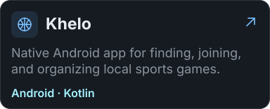
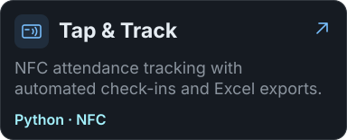
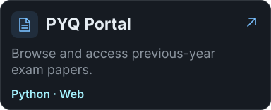
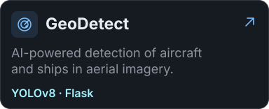
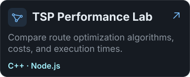
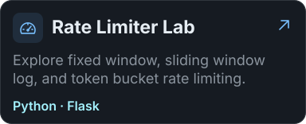
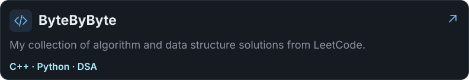
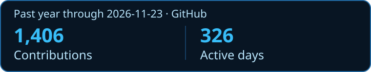

  

I'm a B.Tech Computer Science and Engineering student building native mobile apps and exploring backend engineering, algorithms, and applied AI.

[Connect on LinkedIn](https://www.linkedin.com/in/aditya-bhardwaj-ios/)

## Selected work

<table width="100%">
  <tr>
    <td width="50%"></td>
    <td width="50%"></td>
  </tr>
  <tr>
    <td width="50%"></td>
    <td width="50%"></td>
  </tr>
  <tr>
    <td width="50%"></td>
    <td width="50%"></td>
  </tr>
  <tr>
    <td colspan="2"></td>
  </tr>
</table>

## GitHub activity

<picture>
  <source media="(prefers-color-scheme: dark)" srcset="https://raw.githubusercontent.com/Aditya-xcity/Aditya-xcity/output/snake-dark.svg">
  
</picture>

The activity card and snake refresh daily from GitHub's contribution calendar.
