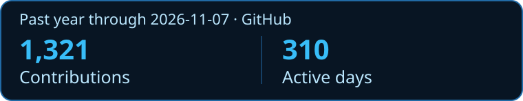

  

I'm a B.Tech Computer Science and Engineering student building native mobile apps and exploring backend engineering, algorithms, and applied AI.

[Connect on LinkedIn](https://www.linkedin.com/in/aditya-bhardwaj-ios/)

## Selected work

- **[Khelo](https://github.com/Aditya-xcity/Khelo)** — Native Android prototype in Kotlin for finding, joining, and organizing local sports games.
- **[Tap & Track](https://github.com/Aditya-xcity/nfc-attendance-pro)** — Python attendance prototype with NFC card registration, timestamped check-ins, and Excel exports.
- **[PYQ Portal](https://github.com/Aditya-xcity/pyq-portal)** — Exam paper browser backed by a Python manifest generator and GitHub Pages.
- **[GeoDetect](https://github.com/Aditya-xcity/GeoDetect-YOLOv8)** — YOLOv8 training notebook and Flask inference demo for detecting aircraft and ships in aerial imagery.
- **[TSP Performance Lab](https://github.com/Aditya-xcity/tsp-performance-lab)** — C++ solvers, a Node.js API, and a dashboard for comparing route costs and runtimes.
- **[Rate Limiter Lab](https://github.com/Aditya-xcity/RAteLimiiterMock)** — Flask sandbox for comparing fixed window, sliding window log, and token bucket rate limits.

I also keep a [LeetCode practice archive](https://github.com/Aditya-xcity/ByteByByte) with solutions in C++ and Python.

## GitHub activity

<picture>
  <source media="(prefers-color-scheme: dark)" srcset="https://raw.githubusercontent.com/Aditya-xcity/Aditya-xcity/output/snake-dark.svg">
  
</picture>

The activity card and snake refresh daily from GitHub's contribution calendar.
